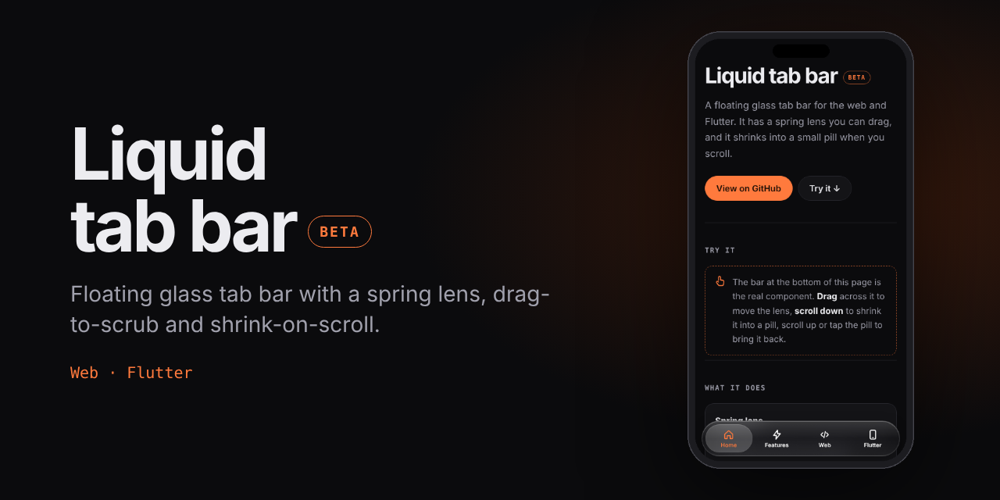
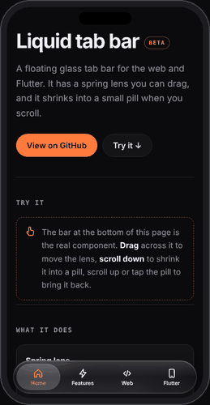
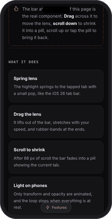
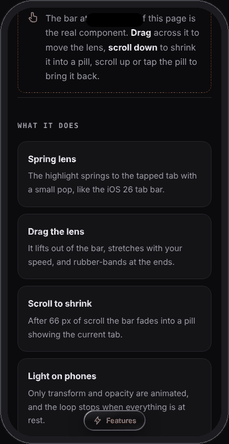

<p align="center"></p>

# Liquid tab bar


A floating glass tab bar in the style of iOS 26, with a spring lens you can drag, and a shrink-to-pill on scroll. One behaviour, two implementations: **plain web (HTML/CSS/JS)** and **Flutter (iOS, Android and Flutter web)**.

> ⚠️ **Beta.** Early version, still changing. The web version works but may have rough edges. The Flutter version has **not been compiled or run yet**. Expect bugs and breaking changes.

<p align="center"></p>

**Live demo:** <https://rex-bit.github.io/Rex-bit/liquid-tab-bar/>

## Contents

- [Features](#features)
- [Installation](#installation)
- [Quick start](#quick-start)
  - [Web](#web)
  - [Flutter](#flutter)
- [Options](#options)
- [How it works](#how-it-works)
- [Limitations](#limitations)
- [Roadmap](#roadmap)
- [Credits](#credits)
- [License](#license)

## Features

| | |
|---|---|
| **Spring lens** | The highlight springs to the tapped tab (damping ratio ≈ 0.77) with a small pop. |
| **Drag the lens** | Press and drag: the lens lifts out of the bar, stretches with drag speed, the icon under it grows, and the ends rubber-band. On release it springs to the nearest tab. |
| **Scroll to shrink** | After 66 px of scroll down the bar crossfades into a pill showing the current tab. 48 px up (or near the top), or a tap on the pill, brings it back. |
| **Cheap on phones** | Only `transform` and `opacity` are animated, the loop stops at rest, and backdrop blur is switched off just during the bar/pill swap. |
| **No dependencies** | The web version is one CSS and one JS file. The Flutter version uses only the Flutter SDK. |

## Installation

**Web:** copy `web/liquid-tab-bar.css` and `web/liquid-tab-bar.js` into your project.

**Flutter:** add it as a path or git dependency in `pubspec.yaml`:

```yaml
dependencies:
  liquid_tab_bar:
    path: ../liquid-tab-bar/flutter
```

## Quick start

### Web

```html
<link rel="stylesheet" href="liquid-tab-bar.css">

<div class="ltb-wrap">
  <nav class="ltb">
    <a href="#home"><svg viewBox="0 0 24 24">…</svg><span>Home</span></a>
    <a href="#search"><svg viewBox="0 0 24 24">…</svg><span>Search</span></a>
  </nav>
</div>

<script src="liquid-tab-bar.js"></script>
<script>
  new LiquidTabBar(document.querySelector(".ltb"), {
    onChange: (index, link) => console.log(index),
  });
</script>
```

### Flutter

```dart
final bar = LiquidTabBarController();

NotificationListener<ScrollNotification>(
  onNotification: bar.handleScroll,   // shrink on scroll
  child: ListView(...),
);

LiquidTabBar(
  controller: bar,
  selectedIndex: tab,
  onChanged: (i) => setState(() => tab = i),
  items: const [
    LiquidTabItem(icon: Icons.home_rounded, label: 'Home'),
    LiquidTabItem(icon: Icons.person_rounded, label: 'Me'),
  ],
);
```

Run the example, also in a browser:

```bash
cd flutter/example
flutter create .        # generates android/ios/web once
flutter run -d chrome
```

## Options

**Web** (`new LiquidTabBar(nav, options)`)

| Option | Default | Description |
|---|---|---|
| `onChange(index, link)` | – | Called when the selected tab changes. |
| `preventNavigation` | `false` | Don't follow the link `href` (for SPAs). |
| `minimizeOnScroll` | `true` | Shrink to a pill when scrolling down. |
| `glass` | `"auto"` | `"auto"` (Apple devices get liquid, others get blur), `"liquid"` or `"blur"`. Needs `liquid-glass.js`. |

Methods: `select(i)` moves the lens without firing `onChange`; `minimize(bool)` shrinks or expands manually.
CSS variables on `.ltb`: `--ltb-accent`, `--ltb-ink`, `--ltb-bg`, `--ltb-lens`.

**Flutter** (`LiquidTabBar`)

| Parameter | Default | Description |
|---|---|---|
| `items` | required | List of `LiquidTabItem(icon, label)`. |
| `selectedIndex` / `onChanged` | required | Controlled selection. |
| `controller` | – | `LiquidTabBarController`: shrink state and `handleScroll`. |
| `accent` | theme primary | Colour of the active tab. |
| `maxWidth` | `460` | Maximum bar width. |

### Glass styles

| `blur` | `liquid` |
|:---:|:---:|
|  |  |
| Classic frosted glass. Light, used by `auto` on Android and other non-Apple devices. | Clear glass with bright edges. In Chromium it also bends the content behind the bar (shown here); on iPhone it is the same look without the bending. |

| Mode | Look | Cost |
|---|---|---|
| `blur` | Classic frosted glass. | Light. Used by `auto` on Android and other non-Apple devices. |
| `liquid` | Clear glass with bright specular edges and inner glow. In **Chromium** it also bends the content behind the bar (SVG displacement map). | Apple devices get the look without the bending, see limitations. |

Load `liquid-glass.js` before `liquid-tab-bar.js`. You can also call `LiquidGlass.set("blur" | "liquid" | "auto")` at any time.

## How it works

- The lens position is a spring (stiffness 380, damping ratio 0.77). Scale uses a softer spring (320, 0.6) so it wobbles slightly.
- While dragging, the target follows the finger, the lens turns a flat, lighter gray (like Instagram's iOS 26 bar), grows to ~1.1 wide and 1.13 tall so it overflows the bar slightly, and stretches a little more with finger speed. Past either end the offset is damped by 0.35 and capped at a fifth of a tab.
- Shrinking is a crossfade plus scale between two layers, about 280 ms with `easeOutCubic`. It deliberately avoids animating width or `clip-path`, which are not GPU-composited and caused stutter on iOS.

## Limitations

- **Real refraction needs `backdrop-filter: url(#svg)`, which only Chromium supports.** Safari and iOS ignore it, so on iPhone `liquid` is the clear-glass look without the bending. A WebGL approach works everywhere but needs the page behind the bar as a texture, which is too heavy here.
- This **imitates** the look. It is not Apple's real Liquid Glass: no refraction and no live lensing of what is behind it. For the real native control inside a Flutter app on iOS 26, use [adaptive_platform_ui](https://github.com/berkaycatak/adaptive_platform_ui).
- `backdrop-filter` / `BackdropFilter` is heavy on low-end Android. Use a solid translucent colour there.
- Flutter version untested (see the beta note).

## Roadmap

- [ ] Compile and test the Flutter widget on iOS, Android and web
- [ ] Optional badge on tabs
- [ ] Real refraction on iOS (needs a WebGL scene texture)
- [ ] Haptics on drag (Flutter)
- [ ] Publish to npm and pub.dev

## Credits

Behaviour numbers (shrink threshold, spring damping, lens scale, rubber-band) come from reading the descriptions of [liquid_glass_nav_bar](https://github.com/rokncode/liquid_glass_nav_bar) and [facebook/astryx PR #8154](https://github.com/facebook/astryx/pull/8154). No code was copied; both implementations here are written from scratch.

## License

[MIT](LICENSE) © rex-bit
